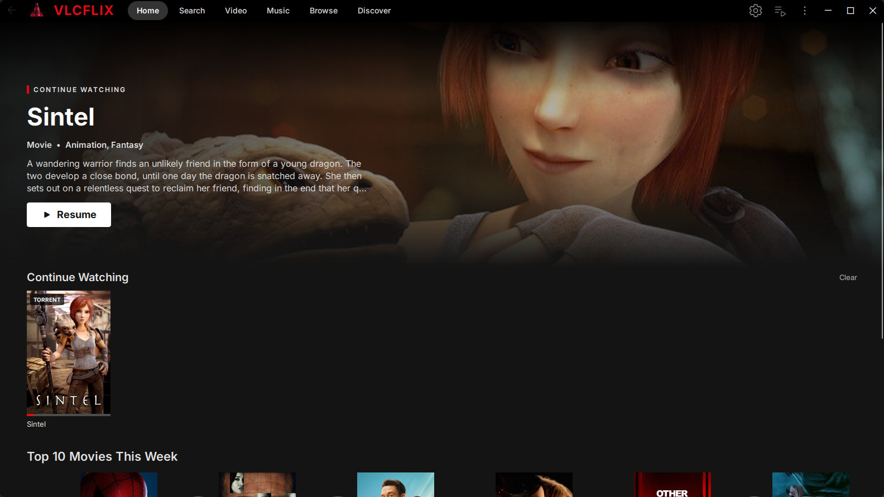
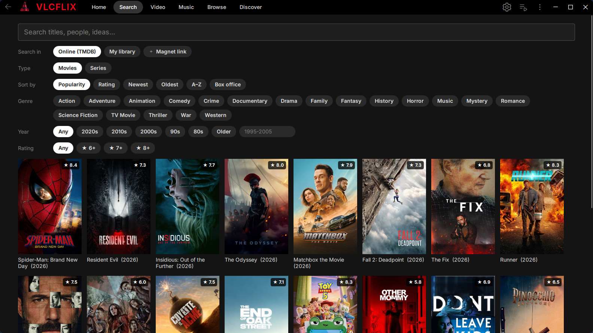
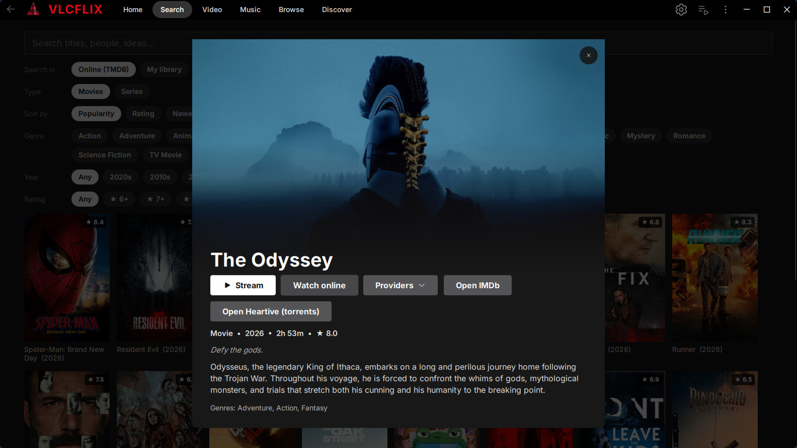
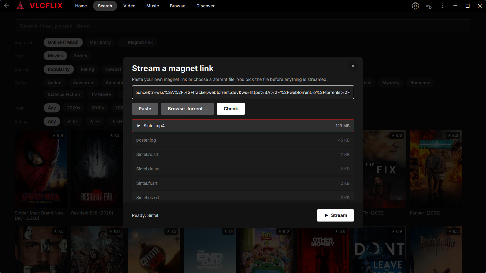
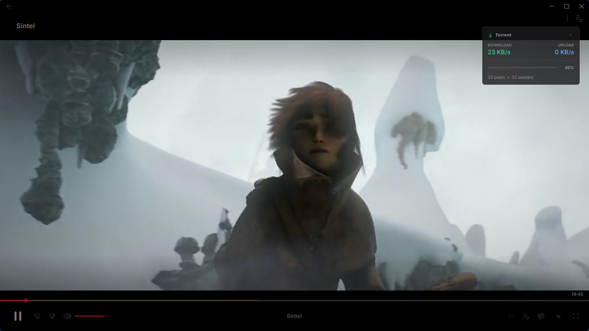
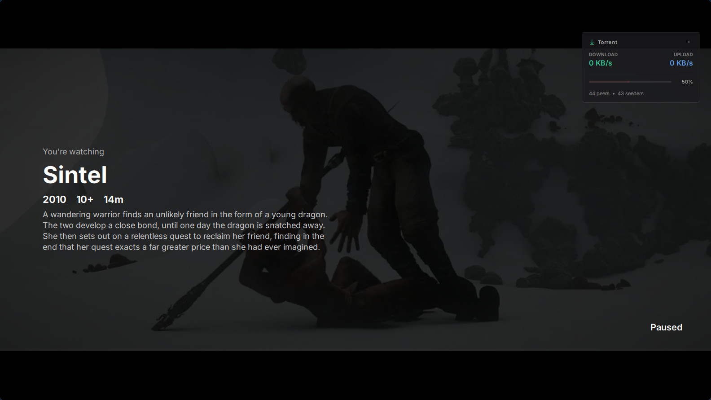
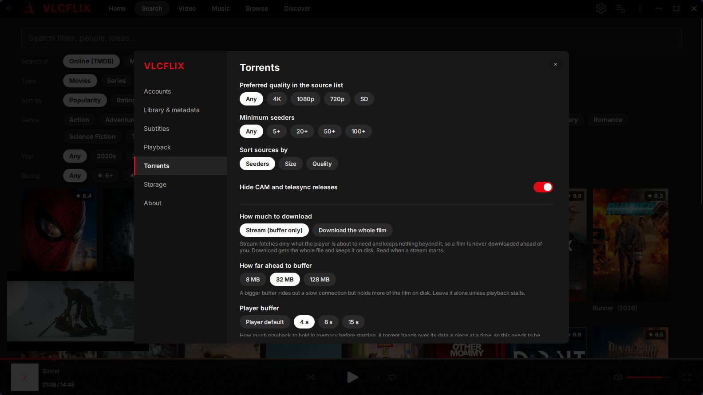

# VLCFlix

VLC 4 with the front end of a streaming service: a Home screen for your own films, artwork
and synopses from TMDB, subtitles from OpenSubtitles, and torrent streaming that picks up
exactly where you stopped. Underneath it is still VLC, so it plays everything VLC plays.



**[Download for Windows](https://github.com/alunit3/vlc-flix/releases/latest)**: installer
or zip, Windows 10/11 64-bit.

---

## What it adds to VLC

### A Home screen that knows what you watch

Continue Watching sits at the top: local files, torrents and online players alike, each with
its position. Below are your library, recently added files and TMDB's weekly Top 10. Point
**Add movie folder** at your films and they show up with posters and synopses instead of
file names. Release names like `Some.Movie.2001.1080p.BluRay.x264` are cleaned up to
"Some Movie (2001)" everywhere titles are shown.

### Search and More Info



Search TMDB by title, or browse by genre, decade, rating and popularity, for films and
series. Every card opens a details panel with the synopsis, runtime and rating, and two
ways to watch: **Stream** (torrent) or **Watch online** (a streaming provider's own player
in a separate window). Films from your library play from your own copy.



### Torrent streaming



Pick a source for a title (sorted by seeders, filtered by quality, CAM releases hidden), or
paste your own magnet link or `.torrent` file and choose which file to play. Playback starts
while it downloads, and a small card in the player shows speed, peers and progress.



Resuming is fast because nothing is thrown away. Each torrent keeps its own folder on disk
(capped at a size you choose, oldest removed first), its metadata is saved, and the player
opens directly at the saved second instead of starting from the beginning. On the test
torrent a resume is ready in under a second.

By default only the part you are about to watch is fetched. Settings switch that to
downloading the whole file, set the buffer sizes and cap the speeds.

### The player



- Pausing with the mouse idle shows what you are watching: title, year, age rating, runtime
  and synopsis.
- A title starts with its age rating in the corner, and a resumed one says
  "Resuming from 12:34" with a **Start over** button.
- Hovering the seek bar shows a frame from that point.
- When a film starts without subtitles, VLCFlix finds the best match on OpenSubtitles and
  offers it, or adds it straight away if you prefer. A **Find Subtitles Online** window
  searches by hand. Either way, the subtitle you chose comes back on its own the next time
  you play that film.

### Settings in one place



Accounts with a Test button for each key, library and metadata language, subtitle
languages, playback, torrent behaviour, and a Storage page that shows what each cache takes
on disk and clears it. VLC's full preferences are still there for everything else.

### Smaller things

- Its own settings folder (`%APPDATA%\VLCFlix`) and app identity, so it installs next to a
  regular VLC without sharing settings, the taskbar group or the single-instance lock.
- Checks this repository's releases once a day and says on Home when there is a newer
  version. It can be switched off in Settings → About.
- Fixed in the VLC code it is built on: crackling 5.1 audio through WASAPI (a channel
  reorder applied twice to partly written blocks), Lua extensions that could not be reopened
  after their thread ended, and a few stack leaks in the Lua dialog code.

---

## Getting started

1. Install, run `vlcflix.exe`.
2. In **Settings → Accounts**, add a free [TMDB read access token](https://www.themoviedb.org/settings/api)
   for artwork, search and the Top 10, and an [OpenSubtitles](https://www.opensubtitles.com/consumers)
   API key and account for subtitles. Nothing is fetched until these are set, and they stay
   on your PC.
3. **Add movie folder** on Home, or stream something.

Watch online needs the Microsoft Edge WebView2 runtime, which is part of Windows 11.

The installer is not code-signed yet, so SmartScreen warns the first time (More info → Run
anyway). The first torrent stream also brings up a Windows Firewall prompt for
`flixtorrent.exe`; streaming works either way, and allowing it lets more peers connect to you.

---

## Building

The Windows build runs in VideoLAN's own build container, with prebuilt dependencies, so the
only things needed locally are Docker Desktop and Go 1.24+.

```powershell
.\flix\build.ps1 -Package -Jobs 4   # first, full build; a runnable tree lands in ..\run
.\flix\dev.ps1                      # afterwards: incremental build, swaps the new files in
.\flix\dev.ps1 -Launch              # ...and starts it
```

`dev.ps1` also rebuilds the two Go helpers (`flixtorrent.exe`, `flixweb.exe`) when their
sources change. Give Docker Desktop plenty of memory (Settings → Resources); with 2 GB
the build runs out of it.

Releases are built by GitHub Actions ([`.github/workflows/release.yml`](.github/workflows/release.yml)
and [`flix/ci/build-win64.sh`](flix/ci/build-win64.sh)). Run the **Build** workflow by hand
for test artifacts, or push a tag `vX.Y.Z` matching `FLIX_VERSION` in `configure.ac` to get
a draft release with the installer, the zip and `SHA256SUMS`.

### Where things live

| Path | What |
| --- | --- |
| `modules/gui/qt/**/Flix*.qml` | The VLCFlix screens: Home, Search, More Info, dialogs, player overlays, Settings |
| `modules/gui/qt/maininterface/mainctx.cpp` | Glue between the screens and everything else: torrent sessions, resume, storage, settings |
| `share/lua/intf/flixsubs.lua` | Background service: TMDB metadata, OpenSubtitles, remembered subtitles, update check |
| `share/lua/extensions/FlixSubs.lua` | The **Find Subtitles Online** window |
| `flix/torrent/` | Torrent helper (Go, [anacrolix/torrent](https://github.com/anacrolix/torrent)): sources, metadata, local HTTP stream |
| `flix/web/` | Watch online window (Go, WebView2) |
| `src/text/release_name.c` | Release-name parser behind the cleaned-up titles |
| `flix/UPSTREAM` | The VLC commit this is based on, and the build image |

---

## Notes

- VLCFlix does not host, index or search for media on its own. Torrent sources come from
  public Stremio addons, and nothing is downloaded until you pick a source and press Stream.
  Torrent peers see your IP address. You are responsible for what you stream.
- This product uses the TMDB API but is not endorsed or certified by TMDB.
- Not affiliated with VideoLAN or Netflix. "VLC" and the cone are trademarks of VideoLAN.
- Third-party code and services are listed in [`flix/NOTICE.md`](flix/NOTICE.md).

## License

VLCFlix is a fork of [VLC](https://code.videolan.org/videolan/vlc) and, like VLC, is released
under the GNU General Public License, version 2 or later ([COPYING](COPYING)). libVLC keeps
its LGPL-2.1-or-later license.
